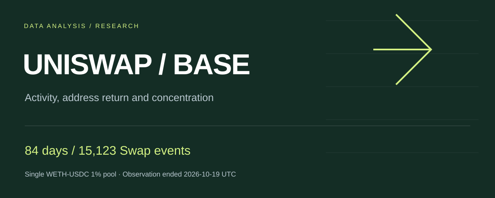

# Base链Uniswap单池活动、地址回访与集中度分析

[English](README.md) · **简体中文**



围绕Base上一个Uniswap v3 WETH/USDC 1%费率池，研究谁在参与、首次观察地址是否回来，以及金额增长是否依赖少数头部地址。

[中文案例](reports/case-study.zh-CN.md) · [English case study](reports/case-study.en.md) · [完整报告](reports/report.pdf) · [离线看板](app/dashboard.html)

> GitHub 的 HTML 文件预览显示源码。体验看板请下载HTML后用浏览器打开。报告正文和原看板使用中文，案例与摘要同时提供英文版本。

## 问题与发现

- 最近完整周活跃交易发起地址为 **521个，环比增长59.82%**。重新出现组净增104个，占总净增195个的 **53.33%**。这是构成拆解，不是营销归因。
- 对齐同一批 **6个成熟队列、806个地址**，W1回访 **154/806=19.11%**，W2为 **149/806=18.49%**。未成熟单元格保留NA，不填零。
- 最新周按金额排名的Top1%向上取整为 **6个地址**，贡献 **18.61%** 的USDC侧估算金额；同时报告动态头部与固定前周头部两种剔除敏感性。

## 研究范围与来源

链：Base；协议版本：Uniswap v3；费率：1%；池地址：`0x0b1c2dcbbfa744ebd3fc17ff1a96a1e1eb4b2d69`。

取数区间为 **[2026-07-27, 2026-10-19) UTC**，结束日不含；前28天为历史缓冲，后8个完整周展示。覆盖完整单池总体：**15,123条Swap事件、14,300笔去重交易、2,086个父交易发起地址**。

通过公开Base RPC获取日志与父交易，使用USDC每日历史价格估算美元金额。一个完整日和8笔跨周交易收据作独立来源抽查；并未通过第二来源重新取得全部84天。

## 指标与分析方法

- 活跃地址采用父交易的 `from` 字段代理；事件按候选键检查，交易按哈希去重，事件行数不充当交易数。
- 每周活跃地址分为区间内首次观察、连续活跃、间隔后重新出现，三组互斥并与每周总量对齐。
- 首次观察队列采用自然周W1/W2回访，W2不要求W1出现；比较时使用同批成熟队列。
- 金额与交易数集中度独立排名，分别说明总体、取整与剔除规则，不混用两套头部集合。

## 如何复算

使用 Python 3.10或更新版本，仅需标准库，无需账号、密钥、网络或额外包。进入本仓库文件夹执行：

```text
python scripts/reproduce.py
```

脚本以随仓库提供的事件数据库为只读输入，在内存重建SQL视图，核对总体计数、8周结果、同批成熟队列人数及最新周头部金额份额。成功输出 `"passed": true`，原始数据库保持不变。

该流程复算本地结构化快照，不执行全量链上重新取数。

## 文件结构

| 路径 | 内容 |
| --- | --- |
| `reports/` | 中文报告与英文摘要 |
| `app/` | 可离线打开的交互看板 |
| `sql/` | 趋势、地址分组、队列和集中度查询 |
| `data/` | 事件数据库与正式结果CSV |
| `scripts/reproduce.py` | 只读复算与对照 |
| `SOURCE-NOTES.md` | 来源范围和快照校验值 |

## 运营含义与解释边界

建议在固定周报中联合监测地址构成、成熟回访与集中度；进一步补充跨池活动、交易间隔和授权产品漏斗，再评估体验问题。

地址是代理，不是真实人数；USDC侧金额是交换片段估值，不是收入或净流入；单池缺席不等于协议流失；剔除敏感性不模拟真实退出。没有运行营销活动、随机实验或取得可验证的效果提升。
