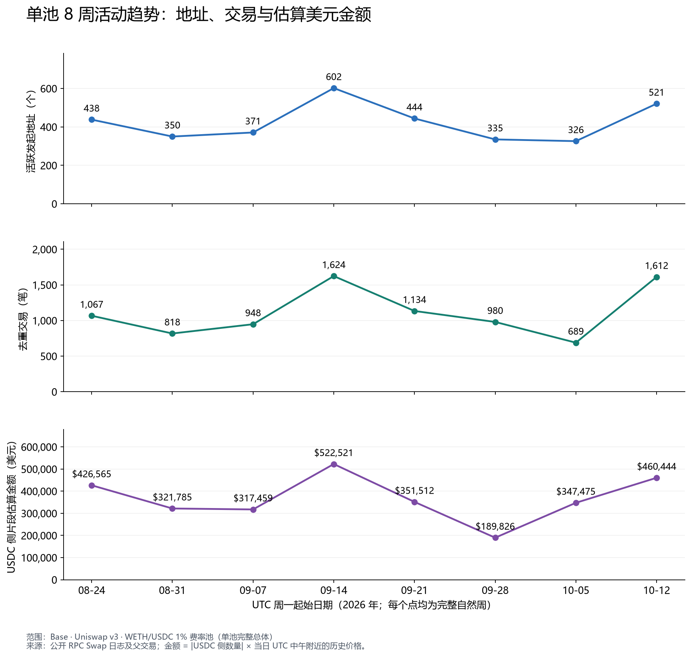
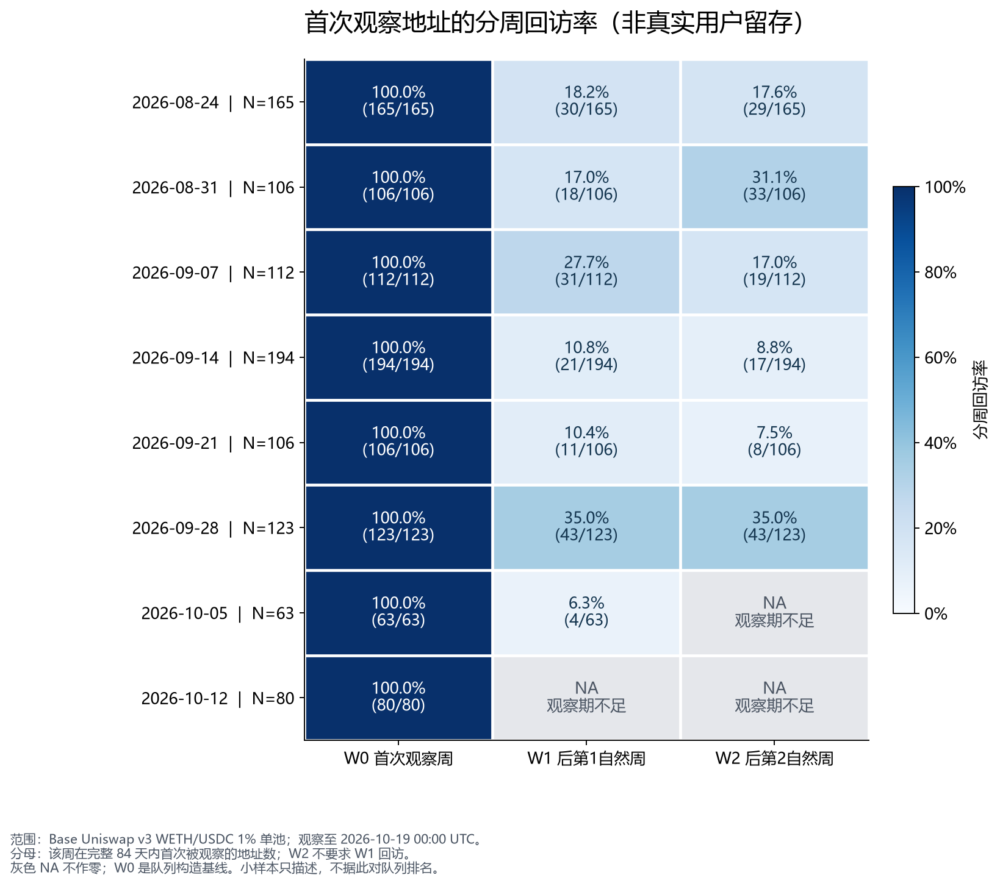
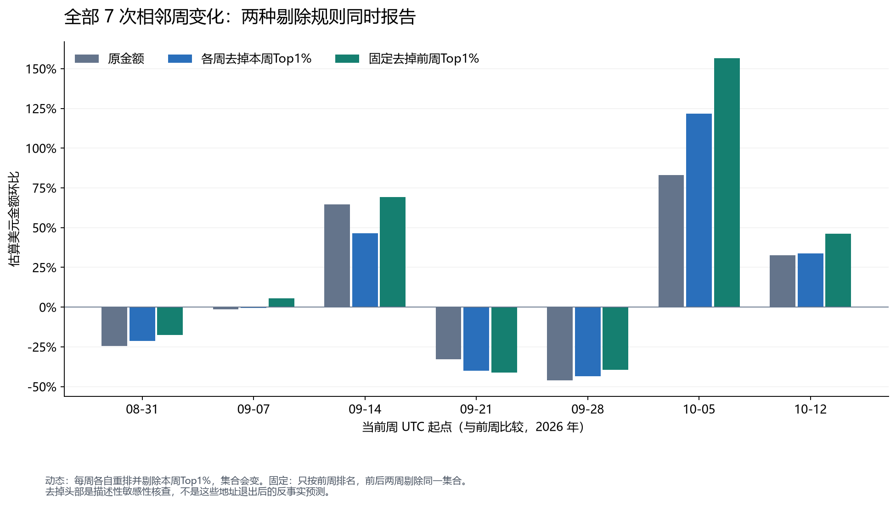

← 返回作品集 / SELECTED WORK

RESEARCH 01 · ONCHAIN PRODUCT ANALYTICS

# 一次活动回升， 是谁带来的？

以Base上Uniswap v3 WETH/USDC 1%费率池为例，拆解参与活动、首次观察地址回访与交易集中度，判断哪些结论足以支持运营研究。

观察期 / 2026.07.27 — 10.19 UTC（结束日不含）SQL · Python · Cohort Analysis完成 / 2026.10
[完整报告 PDF ↗](report.pdf) · [交互看板 ↗](../app/dashboard.html)SQL与数据 ↓[English summary ↗](english-summary.md)

01 / QUESTION

## 活动增长，是更多地址参与，还是头部交易拉动？

协议交易次数、地址数量和交易金额可能朝不同方向变化。研究把这个问题拆成三部分：活跃地址的构成是否改变；首次观察地址在后续自然周是否再次出现；金额在少数发起地址间是否高度集中。

数据覆盖84天，共15,123条Swap事件、14,300笔去重交易、2,086个交易发起地址。前28天作为历史缓冲，后8个完整周展示。分析使用父交易的`from`字段作为地址代理，不将其等同于人数或网站访客。

02 / FINDINGS

## 三项发现，回答不同的问题。

**+59.82%**

### 参与活动回升

最近完整周活跃地址326→521；重新出现组增加104个，占净增195个的53.33%。

**19.11%**

### 同批队列W1回访

统一6个成熟队列，154/806在下一自然周回访；W2为149/806，即18.49%。

**18.61%**

### 头部金额贡献

最近周金额Top1%向上取整为6个地址，贡献18.61%的USDC侧估算金额。

03 / ACTIVITY

## 地址、交易和金额一起看，增长的含义才清楚。

同一池、同一周边界。不同单位分面展示；金额为USDC侧交换片段的日历史价格估算。

最近周活跃地址增长59.82%，交易数增长133.96%，估算金额增长32.51%。三种规模指标不同步。将地址按首次观察、连续活跃、间隔后重新出现划分后，三组差额分别为+17、+74、+104。

重新出现组是本次活动构成的重要线索。组内成员每周变化，这种算术拆解不能证明召回营销有效；后续需要跨池活动、交易间隔和真实触达证据。

04 / ADDRESS RETURN

## 观察不足，不应显示为“零回访”。

W1、W2为后续第1、第2自然周；W2不要求W1出现。每地址每周最多一个活动标记。

全部成熟W1为158/869，全部成熟W2为149/806，分母覆盖不同队列。统一为同一批806个地址后，W1为19.11%，W2为18.49%。不能直接比较不同成熟度总体，或将每队列百分比简单平均。

首次观察仅针对本池84天窗口。单池缺席不等于离开Uniswap，一个地址也不一定代表一个真实用户。

05 / CONCENTRATION

## 增长在头部剔除后仍存在，但这不是退出预测。

最近周原估算金额增长32.51%。各周分别剔除该周金额Top1%地址后，剩余金额增长33.66%；固定前周4个头部地址，从两周同时剔除后，剩余金额增长46.24%。

动态集合与固定集合回答不同问题，所有相邻周结果同时展示。剔除计算未模拟流动性、价格和路由的反馈。

按交易数独立排名的Top1%贡献24.88%的交易；按金额选出的6个地址贡献21.96%的交易。这两组不能混用。集中度必须同时说明度量、总体、取整和排名规则。

06 / IMPLICATIONS

## 把发现转成有边界的下一步。

把三类地址活动纳入固定周报

优先研究重新出现地址的交易间隔和路由背景；先补充跨池证据，再考虑召回研究。不要把构成差额当成渠道贡献。

先区分未回本池与离开协议

补充同协议其他池的活动，再结合费用、失败交易及授权产品漏斗研究体验问题。当前地址队列不是产品用户级7日留存。

联合监测规模、回访和集中度

同时呈现活跃地址、成熟回访、金额与交易数集中度，并保留两种敏感性规则。没有运行运营实验，建议尚无因果效果验证。

07 / METHOD & QUALITY

## 结果之外，保留计算依据。

- 3,696个连续、不重叠区块段获取交换事件，补全全部父交易发起地址。

- 按UTC日、周分别去重；370笔交易包含多个同池事件，事件行数不作为交易数。

- 原始事件独立复算，与SQL的地址分组、回访人数和集中度对照。

- 一个完整日302条事件与独立节点比对，另抽查8笔跨周收据；该抽查不等于第二来源重取全部84天。

- USDC整数金额保留，日价估算美元汇总允许绝对浮点误差0.000001美元；未成熟队列保留NA。

研究限定于Base Uniswap v3 WETH/USDC 1%费率池。金额是交换片段估值，不是净流入或收入；未识别真实用户身份，未声称剔除机器人或洗量。

08 / EXPLORE THE EVIDENCE

## 继续阅读，或直接检查数字。

[8页完整分析报告 ↗](report.pdf) · [三页交互看板 ↗](../app/dashboard.html) · [SQL、CSV与来源说明 ↗](https://github.com/xiwang-geo/uniswap-base-analysis)[English summary ↗](english-summary.md)

图表与结果来源：已归档分析的原始结果表。网站只作展示编排，不新增研究样本或改变计算口径。

RESEARCH 02 / FINANCIAL PRODUCT

## 另一个问题：同指数ETF怎样比较？

五只产品、三个窗口，从费用与跟踪表现走向基金比较工具。

[阅读ETF研究 ↗](https://github.com/xiwang-geo/csi300-etf-analysis)

DISCUSS THE WORK

## 欢迎交流方法与业务问题。

[Email ↗](mailto:xiwang.geo@outlook.com)
